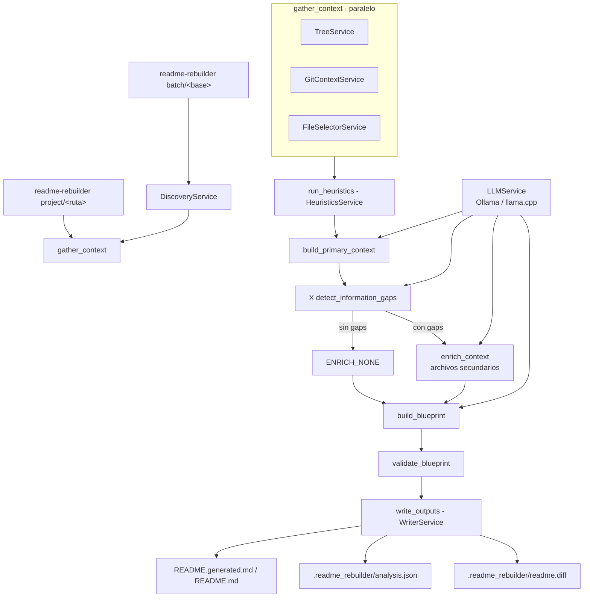
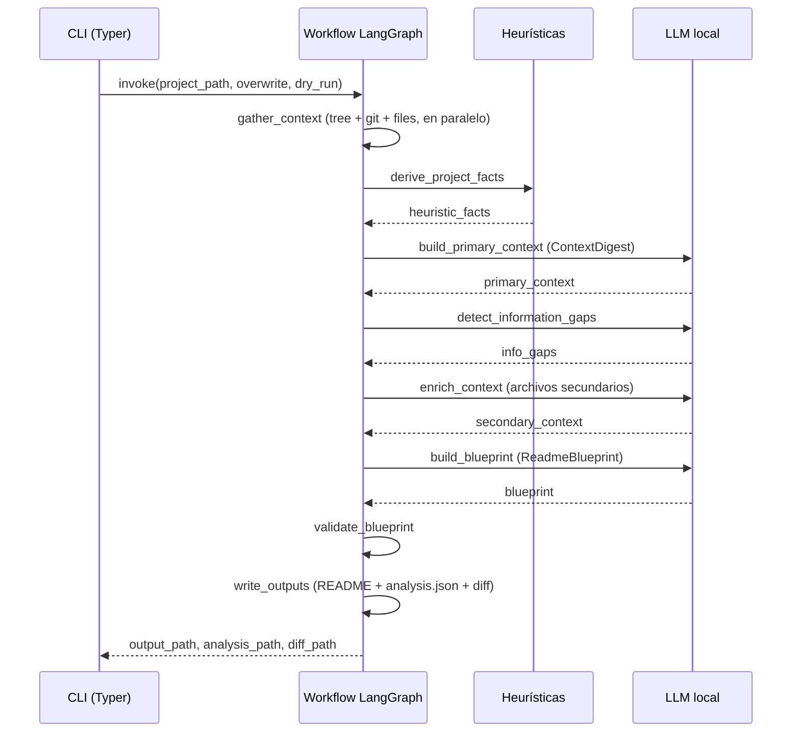

# readme-llm-gen — Local README Rebuilder

Proyecto en Python para recorrer directorios locales, detectar proyectos o repositorios, analizar sus archivos clave y generar o reconstruir un `README.md` profesional usando LangGraph y un LLM local vía Ollama o llama.cpp.

[](https://python.org)

## Contenido

- [Características](#características)
- [Arquitectura](#arquitectura)
- [Stack](#stack)
- [Estructura del repositorio](#estructura-del-repositorio)
- [Instalación](#instalación)
- [Uso](#uso)
- [Configuración](#configuración)
- [Tests / CI](#tests--ci)
- [Roadmap](#roadmap)
- [Licencia](#licencia)

## Características

- Descubrimiento de proyectos en un directorio base mediante marcadores (`.git`, `pyproject.toml`, `package.json`, `Dockerfile`, `app.py`, etc.).
- Selección primaria y secundaria de archivos clave, respetando exclusiones del proyecto.
- Heurísticas locales (lenguajes, frameworks, entrypoints) combinadas con contexto de git.
- Pipeline LangGraph: contexto primario, detección de gaps, enriquecimiento, blueprint, validación y escritura segura.
- Adapters LLM formales para Ollama, llama.cpp server y llama.cpp local.
- Preflight del LLM con fallback automático de modelo y reporte de modelos detectados.
- Modo `--fast` con prompt reducido (~3x más rápido en modelos 7B).
- Soporte para `.readme-rebuilderignore`.
- Diff unificado contra README existente en `.readme_rebuilder/readme.diff`.
- Batch concurrente real con `--concurrency` o `batch.concurrency` y reportes JSON/CSV.
- Redacción básica de secretos antes de enviar snippets al LLM.
- Modo `--dry-run` sin escritura en disco y `--overwrite` para reemplazar el README.

## Arquitectura



Flujo por proyecto:



## Stack

| Componente | Tecnología |
|---|---|
| Lenguaje | Python 3.11+ |
| Orquestación | LangChain 0.3.x, LangGraph 0.2-0.3.x |
| LLM Ollama | langchain-ollama |
| LLM llama.cpp server | langchain-openai (extra `llamacpp-server`) |
| LLM llama.cpp local | llama-cpp-python + langchain-community (extra `llamacpp-local`) |
| CLI | Typer |
| Salida / progreso | Rich |
| Configuración | PyYAML, pydantic, python-dotenv |
| Tests / lint | pytest, pytest-cov, ruff (extra `dev`) |

## Estructura del repositorio

```
readme-llm-gen/
├── src/readme_rebuilder/
│   ├── cli.py                     # Comandos Typer (project, batch, export-graph)
│   ├── config.py                  # AppSettings y carga de config.yaml
│   ├── graph/
│   │   ├── state.py               # GraphState (TypedDict)
│   │   └── workflow.py            # Nodes y edges del StateGraph
│   ├── models/
│   │   └── schemas.py             # ContextDigest, GapAnalysis, ReadmeBlueprint
│   ├── prompts/
│   │   └── templates.py           # Templates de prompts
│   ├── services/
│   │   ├── discovery_service.py   # Descubrimiento de proyectos
│   │   ├── file_selector_service.py
│   │   ├── git_context_service.py
│   │   ├── heuristic_service.py   # Heurísticas locales
│   │   ├── llm_adapters.py        # Adapters Ollama / llama.cpp
│   │   ├── llm_service.py
│   │   ├── tree_service.py
│   │   └── writer_service.py      # Escritura segura + diff
│   └── utils/
│       ├── fs_walk.py
│       ├── logging.py
│       ├── observability.py       # ConsoleRunObserver
│       ├── path_filters.py
│       └── project_ignore.py      # .readme-rebuilderignore
├── tests/
├── config.yaml                    # Configuración principal
├── .env.example
├── langgraph_workflow.mmd          # Grafo exportado (Mermaid)
├── langgraph_workflow.png
├── pyproject.toml
└── README.md
```

## Instalación

```bash
python -m venv .venv
source .venv/bin/activate
pip install -U pip
pip install -e .
cp .env.example .env
cp config.yaml config.local.yaml
```

Instalar extras según el backend deseado:

```bash
pip install -e ".[llamacpp-server]"   # llama.cpp server
pip install -e ".[llamacpp-local]"    # llama.cpp local (llama-cpp-python)
pip install -e ".[all]"               # todos los backends
```

## Uso

### Ollama

```bash
ollama pull qwen2.5:7b
readme-rebuilder project /ruta/al/proyecto --verbose
```

### llama.cpp server

```bash
llama-server -m /ruta/modelo.gguf --host 0.0.0.0 --port 8080
readme-rebuilder project /ruta/al/proyecto --config config.yaml --verbose
```

### llama.cpp local

Configura `llm.backend=llamacpp` y `llm.llamacpp_model_path=/ruta/modelo.gguf`.

### Proyecto individual

```bash
readme-rebuilder project /ruta/al/proyecto --verbose
```

### Sin escribir archivos

```bash
readme-rebuilder project /ruta/al/proyecto --dry-run
```

### Lote con concurrencia

```bash
readme-rebuilder batch /ruta/base --concurrency 4 --verbose
```

### Exportar el grafo LangGraph

```bash
readme-rebuilder export-graph ./out --config config.yaml
```

Opciones principales del comando `project`/`batch`: `--config`, `--model`, `--overwrite`, `--fast`, `--dry-run`, `--no-analysis-json`, `--verbose`, `--show-thinking`, `--debug-llm`; adicionales en `batch`: `--max-projects` y `--concurrency`.

### Ignore file del proyecto

Puedes crear un archivo `.readme-rebuilderignore` en la raíz del proyecto analizado:

```text
# ignorar directorios
samples/
docs/

# ignorar patrones
artifacts/*.json
src/generated_*.py
```

### Salidas

Por cada proyecto se genera:

- `README.generated.md` (o `README.md` con `--overwrite`).
- `.readme_rebuilder/analysis.json`.
- `.readme_rebuilder/readme.diff`.

En modo lote además:

- `.readme_rebuilder/batch_report.json`.
- `.readme_rebuilder/batch_report.csv`.

## Configuración

Variables de entorno (ver `.env.example`):

| Variable | Default | Descripción |
|---|---|---|
| `OLLAMA_BASE_URL` | `http://localhost:11434` | URL base de Ollama |
| `OLLAMA_MODEL` | `qwen2.5:7b` | Modelo por defecto |
| `OLLAMA_TEMPERATURE` | `0.1` | Temperatura de muestreo |
| `MAX_FILES` | `18` | Límite de archivos |
| `MAX_FILE_CHARS` | `10000` | Límite de caracteres por archivo |
| `MAX_TOTAL_CHARS` | `85000` | Límite total de contexto |
| `OUTPUT_README` | `README.generated.md` | Nombre de salida |

Configuración en `config.yaml` (secciones):

| Sección | Parámetros clave |
|---|---|
| `llm` | `backend`, `base_url`, `model`, `llamacpp_base_url`, `llamacpp_model_path`, `llamacpp_n_ctx`, `llamacpp_n_threads`, `llamacpp_n_gpu_layers`, `temperature`, `timeout_seconds`, `retry_count` |
| `discovery` | `max_depth`, `include_hidden`, `exclude_dirs`, `project_markers` |
| `scanner` | `max_files`, `max_file_chars`, `max_total_chars`, `max_tree_entries`, `max_tree_depth`, `tree_mode`, `tree_timeout_seconds`, `exclude_dirs`, `important_file_patterns` |
| `output` | `readme_name`, `report_dir`, `save_analysis_json`, `persist_source_snippets`, `redact_secrets`, `write_atomically`, `save_readme_diff`, `diff_context_lines` |
| `batch` | `concurrency` |

Seguridad y privacidad:

- Por defecto `analysis.json` guarda metadatos de archivos seleccionados, no snippets (salvo configuración explícita).
- El selector aplica redacción básica de secretos comunes antes de enviar snippets al LLM.
- El diff permite revisar cambios antes de sobrescribir el README.

## Tests / CI

```bash
pip install -e ".[dev]"
pytest -q
ruff check .
```

Suite de tests que cubre discovery, heurísticas, ignore rules, diff, tree, writer y adapters LLM (incluido preflight). No hay workflow de CI en el repositorio.

## Roadmap

- [x] Pipeline LangGraph con contexto primario/secundario, gaps y blueprint
- [x] Adapters para Ollama, llama.cpp server y llama.cpp local
- [x] Batch concurrente, diff y `.readme-rebuilderignore`
- [x] Exportación del grafo a Mermaid/PNG
- [ ] Soporte de backends remotos (API comerciales) vía adapters adicionales
- [ ] Evaluación de calidad del README generado (métricas)
- [ ] Modo watch o autodetección de repos cambiados

## Licencia

Sin archivo LICENSE declarado en el repositorio.